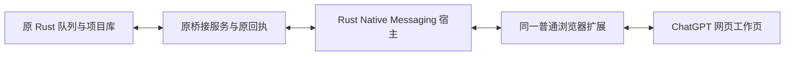

# ChatGPT 网页 Native Messaging 原型

本轮基线 `00715f7`，分支 `integration/native-messaging-20261015`。用户选择保留 ChatGPT 网页的成图效果，授权试验普通浏览器与 Rust Native Messaging；未改用 CLI/API 出图。图片仅限已有套餐内无额外按张收费的授权，视频禁止提交。

## 实现边界

新增独立 Rust 组件 `apps/native-browser-host`，Windows GUI 子系统 EXE，通过浏览器正式的 `runtime.connectNative` / stdio 长连接承接扩展传输。一个端口最多八条隔离通道，每条仍与现有本机桥接服务器建立 WebSocket；它没有访问 ChatGPT 私有接口，没有复制 cookies，也没有取代网页执行。

该阶段只替换传输和补充诊断，不声称已把全部扩展 session 状态迁到 Rust。父资产调度、冻结请求、原 Protocol 5 身份、未知提交保护、原回包和采用流程继续使用原实现。没有替换第二阶段 skill、提示词、模型或渲染方式。

新模式以已安装扩展 manifest 的 `nativeMessaging` 权限显式启用；旧 manifest 仍走原 WebSocket。Native 模式故障不暗中降级到第二条传输，也不缓存或重发创作提交。后台按上限三十秒退避重连，原回执仍负责判定是否可恢复。

## 宿主、消息与安装

- 宿主对调用者 origin 和同目录配置逐字匹配，服务仅允许配置中的规范 `http://127.0.0.1:port`，拒绝路径、凭据、查询、外网与归一化别名。
- 普通消息保持原始字符串。大消息以 192 KiB UTF-8 字节分片，最多 32 MiB；扩展验证顺序、长度和整体 SHA-256。小文本因 JSON 转义超出 Native 单帧上限时，也使用单片运输。
- 有界通道和队列；单通道失败保持隔离，宿主断连关闭对应端口，原任务不会因此重发。stdin EOF 回收工作线程；错误输出只用固定代码，token 不写磁盘、参数或日志。
- 固定宿主名 `app.director.browser_bridge`。安装脚本只读正常 Edge/Chrome 中已经登记的准确扩展路径，生成精确 `allowed_origins`，注册本用户 NativeMessagingHosts。没有改浏览器 Preferences、系统策略、cookies 或用户 profile。
- 宿主安装在本机固定组件目录，更新仅留一个宿主备用。正式桌面 EXE 当前版和唯一备用版不变。
- 安装 JSON 一律按 UTF-8 读取；解析错误只返回固定代码，防止旧 PowerShell 的编码差异或错误报告回显原配置。

部署命令：先 `cargo build --release --locked --manifest-path apps/native-browser-host/Cargo.toml`，再运行 `apps/chrome-bridge/scripts/install-native-host.ps1 -PlanOnly` 核对计划，运行同一脚本安装，最后用 `node apps/chrome-bridge/scripts/apply-overrides.cjs` 部署固定哈希 overlay。`build-native-overlay.cjs` 将独立测试的适配模块原字追加到已有 `authPreflight.js`，不扩大部署器对未知新增目标文件的覆盖权限。

## 已执行证据

| 检查 | 结果与范围 |
| --- | --- |
| 完整桥接回归 | 238/238；含 Native 适配、显式启用、不降级、退避、安装来源与编码保护。合成测试，不是图片验收 |
| Windows Rust release | 18/18；真实 stdio、本机多通道 FIFO、32 MiB 分片、断线零重发、队列限制、EOF 收尾等 |
| GUI 子系统 | 已核验；宿主隐藏启动，当前二进制 720384 bytes，SHA-256 `b5a6260b16cb0acde5dab4625a224f5ea0a6c5d22de24afc833c916063207992` |
| 实际浏览器 Native Port | 隔离 Edge 已实际调用注册宿主、断开后再次连接，撤去 debugger 后闲置 35 秒仍可响应；无账户、无登录、无生成 |
| 浏览器 → Rust → 原服务 | 三条实际认证 WebSocket 通道均收到原服务 `transport.hello`，隔离实例退出后进程树为空；不属于三张图片或三个制作任务 |
| 原数据保护 | 原七项目、十集案例原文及第五集 SDK unknown 原文件和 SQL 表重新核验精确一致 |

真实接入发现宿主启动 origin 含末尾 `/`，既有桥接服务的 HTTP Origin 校验不含 `/`。只修正宿主发送的 HTTP header，配置与启动参数继续严格验证；未放宽后端 origin 或 token 检查。新增严格 Origin 的本机 WebSocket 回归。

隔离 Edge 测试最初把 launcher 正常退出误判为浏览器关闭；随后核对实际 loopback 监听 PID、父 PID、创建时间、唯一测试 profile 与实际启动参数，才控制对应测试实例。Windows Job Object 回执确认测试进程树清空；没有按浏览器名称批量结束进程。

探针曾尝试在 Service Worker 用动态 `import()` 调用已部署适配器，被浏览器规范禁止；生产代码始终为静态 ESM import，不受此探针错误影响。最终探针只在隔离测试 worker 执行逐字节核验的已部署适配器正文，完成三通道接入和闲置测试。失败日志保留，不把这些探针错误归因于账户、网络或网页模型。

## 尚未验收与恢复锚点

普通 Edge 的一次后台升级请求已发出，但旧页面通道在八秒内没有返回 `extension.reload` 回执；保留原 intent，不重复下发。普通浏览器加载新增权限与当前 Native 模式仍待实际核验。文件部署和隔离浏览器成功都不能作为普通已登录浏览器的生成通过证据。

原两资产案例继续沿原基础图任务与会话恢复。原工作页缺失已由完整原生 inventory 证明；没有以新提交替代原图。基础图仍待回收，衍生图等待父图。连续真实图片、父链、原图下载、采用、质量、重启和长时间稳定性尚未通过，本轮实际生成提交为零。第五集 SDK 原提交仍 unknown，未重新创建 workflow。

私有日志、浏览器 profile、原任务 ID、网页 URL、token、项目数据库与请求回包只保留 `.local/validation/native-messaging-20261015` 及原案例目录，不进入 Git。关键证据包含 `bridge-regression.log`、`host-regression.log`、安装计划与回执、各次隔离探针摘要、原升级 intent 和数据保护核验。

浏览器平台依据：[Chrome Native Messaging](https://developer.chrome.com/docs/extensions/develop/concepts/native-messaging)、[Chrome worker 生命周期](https://developer.chrome.com/docs/extensions/develop/concepts/service-workers/lifecycle)、[Edge Native Messaging](https://learn.microsoft.com/en-us/microsoft-edge/extensions/developer-guide/native-messaging)。平台支持不等于本项目已经稳定验收。
