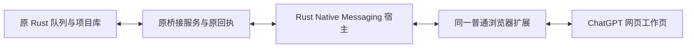

# ChatGPT 网页 Native Messaging 原型

本轮基线 `00715f7`，分支 `integration/native-messaging-20261015`。用户选择保留 ChatGPT 网页的成图效果，授权试验普通浏览器与 Rust Native Messaging；未改用 CLI/API 出图。图片仅限已有套餐内无额外按张收费的授权，视频禁止提交。

## 实现边界

新增独立 Rust 组件 `apps/native-browser-host`，Windows GUI 子系统 EXE，通过浏览器正式的 `runtime.connectNative` / stdio 长连接承接扩展传输。一个端口最多八条隔离通道，每条仍与现有本机桥接服务器建立 WebSocket；它没有访问 ChatGPT 私有接口，没有复制 cookies，也没有取代网页执行。

该阶段只替换传输和补充诊断，不声称已把全部扩展 session 状态迁到 Rust。父资产调度、冻结请求、原 Protocol 5 身份、未知提交保护、原回包和采用流程继续使用原实现。没有替换第二阶段 skill、提示词、模型或渲染方式。

新模式以已安装扩展 manifest 的 `nativeMessaging` 权限显式启用；旧 manifest 仍走原 WebSocket。Native 模式故障不暗中降级到第二条传输，也不缓存或重发创作提交。后台按上限三十秒退避重连，原回执仍负责判定是否可恢复。

## 宿主、消息与安装

- 宿主对调用者 origin 和同目录配置逐字匹配，服务仅允许配置中的规范 `http://127.0.0.1:port`，拒绝路径、凭据、查询、外网与归一化别名。
- 普通消息保持原始字符串。大消息以 192 KiB UTF-8 字节分片，最多 32 MiB；扩展验证顺序、长度和整体 SHA-256。小文本因 JSON 转义超出 Native 单帧上限时，也使用单片运输。
- 有界通道和队列；单通道失败保持隔离，宿主断连关闭对应端口，原任务不会因此重发。stdin EOF 回收工作线程；错误输出只用固定代码，token 不写磁盘、参数或日志。
- 固定宿主名 `app.director.browser_bridge`。安装脚本只读正常 Edge/Chrome 中已经登记的准确扩展路径，生成精确 `allowed_origins`，注册本用户 NativeMessagingHosts。没有改浏览器 Preferences、系统策略、cookies 或用户 profile。
- 宿主安装在本机固定组件目录，更新仅留一个宿主备用。正式桌面 EXE 当前版和唯一备用版不变。
- 安装 JSON 一律按 UTF-8 读取；解析错误只返回固定代码，防止旧 PowerShell 的编码差异或错误报告回显原配置。

部署命令：先 `cargo build --release --locked --manifest-path apps/native-browser-host/Cargo.toml`，再运行 `apps/chrome-bridge/scripts/install-native-host.ps1 -PlanOnly` 核对计划，运行同一脚本安装，最后用 `node apps/chrome-bridge/scripts/apply-overrides.cjs` 部署固定哈希 overlay。`build-native-overlay.cjs` 将独立测试的适配模块原字追加到已有 `authPreflight.js`，不扩大部署器对未知新增目标文件的覆盖权限。

## 已执行证据

| 检查 | 结果与范围 |
| --- | --- |
| 完整桥接回归 | 238/238；含 Native 适配、显式启用、不降级、退避、安装来源与编码保护。合成测试，不是图片验收 |
| Windows Rust release | 18/18；真实 stdio、本机多通道 FIFO、32 MiB 分片、断线零重发、队列限制、EOF 收尾等 |
| GUI 子系统 | 已核验；宿主隐藏启动，当前二进制 720384 bytes，SHA-256 `b5a6260b16cb0acde5dab4625a224f5ea0a6c5d22de24afc833c916063207992` |
| 实际浏览器 Native Port | 隔离 Edge 已实际调用注册宿主、断开后再次连接，撤去 debugger 后闲置 35 秒仍可响应；无账户、无登录、无生成 |
| 浏览器 → Rust → 原服务 | 三条实际认证 WebSocket 通道均收到原服务 `transport.hello`，隔离实例退出后进程树为空；不属于三张图片或三个制作任务 |
| 原数据保护 | 原七项目、十集案例原文及第五集 SDK unknown 原文件和 SQL 表重新核验精确一致 |

真实接入发现宿主启动 origin 含末尾 `/`，既有桥接服务的 HTTP Origin 校验不含 `/`。只修正宿主发送的 HTTP header，配置与启动参数继续严格验证；未放宽后端 origin 或 token 检查。新增严格 Origin 的本机 WebSocket 回归。

隔离 Edge 测试最初把 launcher 正常退出误判为浏览器关闭；随后核对实际 loopback 监听 PID、父 PID、创建时间、唯一测试 profile 与实际启动参数，才控制对应测试实例。Windows Job Object 回执确认测试进程树清空；没有按浏览器名称批量结束进程。

探针曾尝试在 Service Worker 用动态 `import()` 调用已部署适配器，被浏览器规范禁止；生产代码始终为静态 ESM import，不受此探针错误影响。最终探针只在隔离测试 worker 执行逐字节核验的已部署适配器正文，完成三通道接入和闲置测试。失败日志保留，不把这些探针错误归因于账户、网络或网页模型。

## 尚未验收与恢复锚点

普通 Edge 的一次后台升级请求已发出，但旧页面通道在八秒内没有返回 `extension.reload` 回执；保留原 intent，不重复下发。普通浏览器加载新增权限与当前 Native 模式仍待实际核验。文件部署和隔离浏览器成功都不能作为普通已登录浏览器的生成通过证据。

原两资产案例继续沿原基础图任务与会话恢复。原工作页缺失已由完整原生 inventory 证明；没有以新提交替代原图。基础图仍待回收，衍生图等待父图。连续真实图片、父链、原图下载、采用、质量、重启和长时间稳定性尚未通过，本轮实际生成提交为零。第五集 SDK 原提交仍 unknown，未重新创建 workflow。

私有日志、浏览器 profile、原任务 ID、网页 URL、token、项目数据库与请求回包只保留 `.local/validation/native-messaging-20261015` 及原案例目录，不进入 Git。关键证据包含 `bridge-regression.log`、`host-regression.log`、安装计划与回执、各次隔离探针摘要、原升级 intent 和数据保护核验。

浏览器平台依据：[Chrome Native Messaging](https://developer.chrome.com/docs/extensions/develop/concepts/native-messaging)、[Chrome worker 生命周期](https://developer.chrome.com/docs/extensions/develop/concepts/service-workers/lifecycle)、[Edge Native Messaging](https://learn.microsoft.com/en-us/microsoft-edge/extensions/developer-guide/native-messaging)。平台支持不等于本项目已经稳定验收。

## v2：普通浏览器重载后暴露的问题与修复

用户已完成 v1 重载；实际服务曾收到 hello、observer 与页面状态，随后通道断开。现场后台报告过 `queue_full`，因此不是把用户操作认作未完成，也不能用隔离 Port 成功代替普通浏览器可用。

本次按真实合同补齐：

- v1 发送突发消息未等待宿主写入，宿主只有八条队列。v2 要求每次发送有 `writeId`，只有实际 WebSocket write 成功才回 `sent`。适配器每通道仅一条在途，其余进入有限 FIFO（最多 256 条、含在途最多 32 MiB）；确认丢失或断线不重发、不降级。`sent` 只是本机写确认，绝不是服务采用、图片生成完成或 Protocol5 ACK。
- 原 outbox 在每次 ACK 后重复 flush 剩余项，可能放大积压。现按具体 socket 记录已发/正在发的 messageId；同连接不重复发送，只有原 Protocol5 ACK 才删除持久记录。新连接仍恢复剩余原回执，原 body、lease、unknown 不变。
- 宿主旧分片 ID 含冒号，而适配器拒绝该字符。统一改为通道内 `chunk-<sequence>`，用真实 Rust stdout fixture 回放验证两端合同。
- 后台启动独立调用 `ensureConnected()`，没有网页 channel 也建立 Native Port；ready 精确匹配 v2。HTTP 健康报告只证明本机传输，不冒充网页就绪，不创建工作页或发送任务。后续 watchdog 可重建断开的端口。

当前宿主为 718848 bytes，SHA-256 `de234a0ed621f31a344c47b5b74d3225ecfdfaf7f638a85ca1e180cbe4f2bae8`；已按固定计划安装，再部署三份发生变化的 overlay 文件。桌面当前版与唯一备用 EXE 未更换。

新增 Windows 实测：

| 检查 | 实际结果 |
| --- | --- |
| Rust release | 21/21，含真实 64 条发送确认及大消息 stdout fixture |
| 桥接全组 | v2 最终 275/275、零跳过；含旧 controller 所有权丢失安全回归，真实宿主分片 fixture 回放未跳过 |
| 隔离 Edge 两轮跨组件 | 每轮真实浏览器→Native IPC→Rust→独立 loopback WebSocket，64 条 FIFO 精确回传；其中 450018 UTF-8 bytes Unicode 消息按原值和 SHA-256 核验 |
| 无网页后台 Port | 第二轮仅保留生产启动路径建立的端口，撤掉 debugger、闲置 35 秒后，同一 worker 与同一宿主 PID 仍存在；没有用探针另开的 Port 冒充默认启动路径 |
| 测试收尾 | 独立临时 HKCU 测试宿主注册已删除，两轮 Job Object 均证明进程树清空；生产宿主注册未替换为测试注册 |
| 原数据 | 原七项目、十集源文、生产全表和第五集 SDK unknown 证据重新核验一致 |

上述测试均没有账户登录、图片或视频提交。私有探针、页面信息和运行证据仍只在 `.local`。

仍有真实边界：普通 Edge 的旧 `bootstrap_completed` 创建记录尚在，但清空 session 后缺少可验证的页面 owner receipt。持久 tabId、窗口编号、相同 root URL 和两次 inventory 不能排除编号复用的用户页面，因此没有自动认领、导航、重建或伪造 idle。新增独立回归确认这些情形保持 held 且零副作用。需先从真实重新连接的 ChatGPT 页面恢复受认证的源，再使用现有维护恢复合同；独立 background control source 尚未实现，不以原生端口已连接冒充该能力。

普通 Edge 缓存代码加载、原基础图回收与后续父子图稳定性，仍须分别实际验收；本节不宣布网页出图已通过。

## 后续实际接入、读取缺陷和保留的停点

普通已登录 Edge 后来确实连接到 v2 Native 宿主，原 ChatGPT 页面达到 page/composer/chatMain ready。经另一张新建的非活动只读页取得原生清单，旧控制页缺失被证明后，既有恢复合同成功建立新的隐藏控制页；原用户页面 URL 和 content epoch 未被改写。原图片工作页的完整清单结果为 confirmed_absent。正式客户端图片专用后台入口沿原任务恢复，持久预约唯一恢复 alias，重新打开原会话，未发送原提示词。

读取发现真实分支尾部是 `reasoning_recap`，其前一节点才是已完成的 final，图片 tool 输出在更早的同分支。旧代码把第一个 assistant 当 final，导致已有图片仍报 `backend_generation_not_complete`。本轮按实证结构增加精确的呈现尾证据；原 currentNode 和完整 branch 不删除、不改写，原文、单 user、原消息、文件、数量、下载哈希和二次读取校验继续执行。额外 `hide_inline_actions=true` 为失败关闭条件，现场该值未取得最终确认，不能宣称真实原图已经恢复。

另一独立问题是扩展升级接口把同一 background epoch 的内容页刷新误报为 runtime 更新成功。现要求原 tab/profile/server/launch、目标 bundle，以及新的 background/content epoch；owned-only 模式由持久后台协调恢复，不抢先启动内容页刷新计时器。原成功维护命令在压缩中短时保留，防止 command.accepted 已确认后、轮询前被清理而误报 ACK 超时；不改变普通生成、查询或未知状态。

一次显式 `reloadTabs=false` 的后台诊断更新实际取得新 background epoch，并成功加载新版结构诊断，证明已有认证通道能够自主加载补丁。后一次更新则 HTTP 500 超时，原恢复页被旧 standalone command 持续占用；服务 pendingCommands 为零不代表扩展原命令已结算。原命令和更新 intent 均保留，不清锁、不重复升级、不把重新创建图片任务当恢复。后续现场写操作已停在该确切阻塞，最终读取、父图下载、衍生图及多任务稳定性尚未验收。

用户最新建议作为接入方向：由用户普通启动专门用于网页出图的浏览器并登录，工作台验证 Bridge 与网页就绪后绑定该浏览器配置；后续在该浏览器创建受控工作标签页，保留连接页。普通浏览器模式优先，独立自动化 profile 不作默认入口。该方向减少登录环境和用户操作干扰，但不替代本轮已发现的读取、维护确认与未知状态恢复修复；窗口级引导和完整真实制作仍需单独验收。

私人进度记录更新于 `.local/validation/native-messaging-20261015/checkpoint-v2.json`。本轮没有新的图片或视频生成提交，原七项目、十集源与第五集 SDK unknown 证据再次核对不变。`6d145fe` 已推送 v2 传输修复；后续源码修复与实际加载结果分开记录，不以磁盘部署冒充 runtime 已采用。

## 恢复补丁收尾与 Windows 客户端验证

最终冻结源码执行 `node --test apps/chrome-bridge/tests/*.test.cjs`：321/321，零失败、零跳过。Rust 定向验证分别为 `cargo test --locked --manifest-path apps/desktop/src-tauri/Cargo.toml --lib providers::chrome::`（60/60）、同命令过滤 `chrome_terminal::`（6/6）、过滤 `background_chrome_images`（45/45）。这些验证覆盖会话身份、原请求恢复、精确 recap 呈现尾、维护回执保留和后台任务保护，不是网页出图质量或连续批量生成验收。

执行 `cargo build --release --locked --manifest-path apps/desktop/src-tauri/Cargo.toml --features desktop,custom-protocol --bin director-desktop-next` 成功，使用 `apps/desktop/scripts/update-client.ps1 -BuildOnly -CandidatePath <Cargo release EXE>` 准备 SHA 绑定 SDK 资源的独立候选。候选在隔离 home 中两次隐藏运行 `--unvirtualized-desktop --verify-startup <absolute report>`，首次真实 WebView/IPC/SQLite/媒体、项目归档恢复删除、资产删除恢复及单元编辑入口通过；第二次 `saveReopenVerified=true`，原资产及媒体身份保留，两次 `generationRequestsSent=0`、`generationJobs=0`。

随后用同一更新脚本 `-PublishOnly -CandidatePath <prepared candidate EXE>` 轮换固定入口。当前客户端 SHA-256 为 `4a3dc492d2ab22c7e093e56cf613fca0f97c9e00bbe6efdde1aef2311cd16eb5`，唯一备用为上一当前版 `f67b2eb53495926d8036add162523793080350f4f45954cea31c0f001ef5c4e1`；准备候选由脚本按哈希清理。宿主 v2 没有再次修改。

最终 `apply-overrides.cjs` 检查 23 份固定哈希文件，仅部署 3 份剩余差异，未写桥接状态、凭据或原任务。已有服务进程与扩展 worker 没有为加载补丁而强制重启。最终源码的磁盘部署已完成，普通浏览器实际加载和原 standalone command 结算仍未完成；保留原升级 intent，不重复发升级、不清除命令或 journal。最终只读复查仍为 Native 连接存在、页面未就绪；这不能标记为图片制作通过。

复核原生产库全部表、原七项目、十集锁定源文及第五集 SDK unknown 证据精确一致。原基础图、衍生图、多任务稳定性以及第五至十集验收仍待继续，禁止以新请求绕过旧未知提交。

## 专用普通浏览器的建议合同

用户普通启动已登录的 Edge 或 Chrome，保留一个用于连接的 ChatGPT 页面。工作台分别检查 Bridge、登录页状态、网页输入就绪与恢复状态，再绑定全局浏览器配置；窗口或 tab ID 只作本次会话定位，浏览器重启后重新核验，不能当永久所有权凭据。现有 UI 已有普通浏览器全局 profile 绑定；本轮没有新增“已验收专用窗口”选项或承诺窗口级绑定已实现。

后续工作页应在该配置中非活动创建，每图独立会话，默认同时生成一张，其余任务持久排队；提示词准备和已完成图片下载可并行。连接页不承载生产提示词，也不因任务结束而关闭。用户页保持原状，程序只清理有明确创建回执且已入库的工作页。出现登录失效、网页未就绪或断线时暂停派发并显示具体原因，沿保存的原会话链接和请求回执恢复，不自动重发，也不把刷新整个扩展当正常任务步骤。此方案减少登录环境和目标选择问题，但网页生成、下载、父图依赖和重开零重发仍须真实验收。

## 继续稳定性测试：传输就绪不等于网页命令就绪

继续只读检查时，普通 Edge 仍只有 bootstrap Native 连接，`pageReady/composerReady=false`，原 `extension.reload` 命令只有 accepted、没有原 terminal。原工作页与命令未清除，未重复升级或生成。服务已有媒体记录未找到可按原任务及源页身份直接回收的基础图，因此没有把其他历史图片当作本任务结果。

源码核对定位到另一个可复现缺陷：bootstrap hello 可以先建立传输身份，但原 `serverEnvelopeRouter` 在真实 content hello 尚未处理时仍会注册、dispatch 并发出 command.accepted。它随后向尚未就绪的页面转发命令，可能留下永久 dispatched 状态。新增固定哈希 overlay `extension/background/serverEnvelopeRouter.js`：`protocolReady!==true` 或已关闭时，先返回 `CONTENT_RUNTIME_NOT_READY`，不注册新命令、不领取请求 lease、不创建 effect，不伪造取消成功；原命令和未知提交继续保留。ACK、原 outbox 与心跳仍按原协议处理。服务端 reload 协调器也在显式 `transportHealth.backgroundOnly=true` 时，派发前返回 `EXTENSION_RELOAD_CONTENT_NOT_READY`。本轮没有将旧现场命令强行改为成功、失败或可重试。

最终 `node --test apps/chrome-bridge/tests/*.test.cjs` 为 327/327、零跳过。部署器核对 24 份 overlay，未更换桌面 EXE。新增定向测试覆盖 bootstrap-only 的升级、开页、读取、取消及 prompt 命令零派发，原未知记录保留，真实 content 存在后的正常派发，以及 ACK 继续处理。

此外运行两轮真正隔离的 Edge / Native / Rust / loopback WebSocket 测试。每轮 64 条 FIFO 和 450018 UTF-8 bytes 大消息精确回传；原生产路由器、真实 Chrome session storage 和 Protocol5 outbox 实际处理四条 synthetic 入站命令，四条均 `CONTENT_RUNTIME_NOT_READY`、新增命令记录为零、原 synthetic maintenance 命令及 lease 保持原值。撤去 debugger 后闲置 35 秒仍为同一 worker 与默认 Native 宿主。第二轮只中断经 PID、父链及隔离 profile 证明归属的测试宿主，默认后台路径在 22292ms 后自行建立新宿主；同一 worker、原命令/lease 精确保留，无扩展重载、页面刷新或用户操作。该耗时仅是一次隔离故障测试结果，不是恢复时限承诺，也不是图片生成耗时。

两轮 runner 均验证 Job Object 进程树最终为空，临时测试宿主注册已清理。私人证据位于 `.local/validation/native-messaging-20261015/edge-content-readiness-01`、`edge-content-readiness-fault-02` 与对应 `run-*` 摘要。普通浏览器和生产 storage 未被故障注入影响，原七项目、全生产表、十集源文和第五集 SDK unknown 证据再次核验一致。

现场限制继续单列：目前可用的浏览器控制接口只连接普通 Chrome，明确不支持 `visible:false` 静默开页；尝试在建页前即被 capability 检查拒绝，没有退回抢焦点方式，也没有触碰用户现有页面。最终 overlay 已部署在磁盘；普通已登录 Edge 的旧页面没有新的真实 content 握手，也未证实加载本轮修复。原图入库、衍生图接续、真实多图和专用窗口完整验收仍未通过，本轮图片与视频生成提交均为零。
